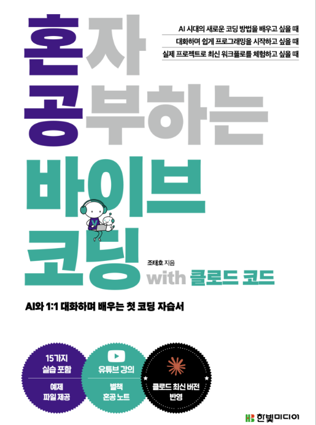

# 회고문
혼공단을 여러번 참여하면서 파이썬이나 자바스크립트와 같은 기초들을 배우고  리액트를 배우고 조금씩 만들어왔는데 세상에....  이제는 AI가 손코딩 대부분을 처리해주는 시대가 와버렸습니다. (~~개발자 취업은.....~~)

시대의 흐름은 못막는 것이니 따라가기라도 해야겠지요.  그래서 이번 바이브코딩 혼공단에 참여했습니다.  (사실 혼자하면 공부를 잘 안해서 ㅎㅎ;;)

클로드가 대세라고 하지만 저는 매번 언더독을 좋아하기 때문에 이번에도 Gemini cli와 antigravty로 동일하게 진행했는데 와...

세상이 정말 미친듯이 빠르게 변화했다는게 느껴질정도 수백줄의 코드를 줄줄 뱉어내는데 공포스럽기도하고 편하기도 해서 뭔가뭔가했네요.

여튼 챌린지 후기를 적어보자면 저자님의 동영상이나 책을 보면서 서브에이전트나 에이전트팀도 구성해보고 MCP도 연결해보고 이리저리 굴러다니니 이정도면 나도 충분히 굴려볼수있겠다 라는 생각이 들었습니다.  

실제로도 서비스를 기획해보고 있고 나중에는 정식으로 배포해서 사이드잡으로 해볼려고 합니다. 
계속해서 공부해서 AI에게 대체되지 않는 인간이 될 수 있게 노력해나가야겠습니다. 